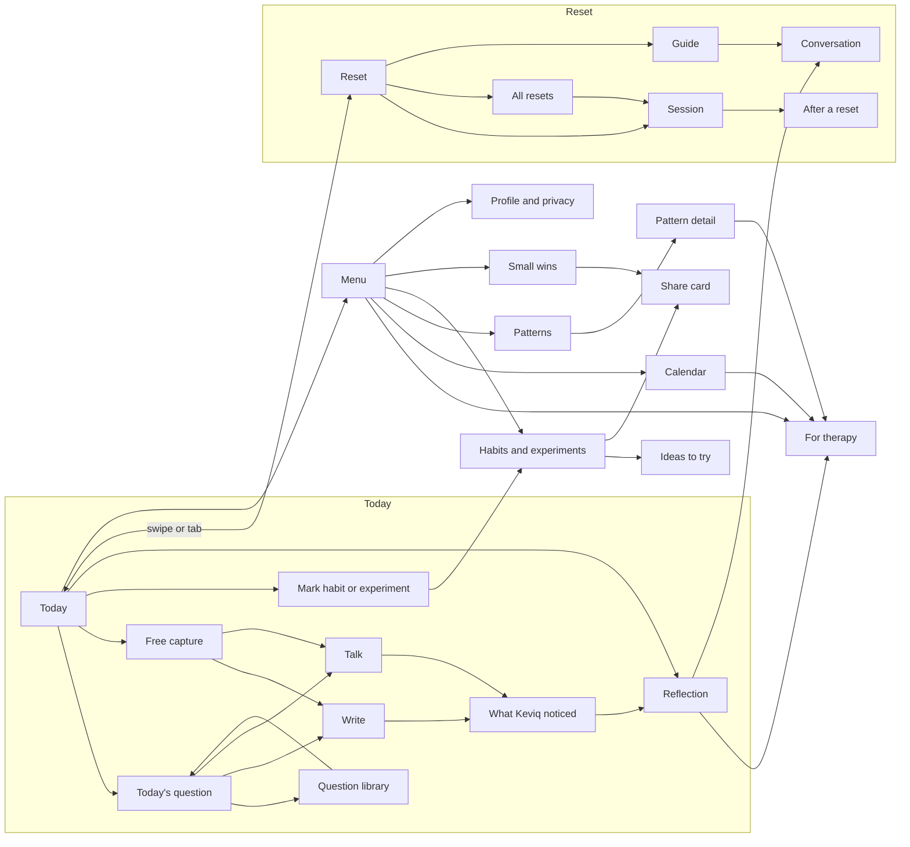
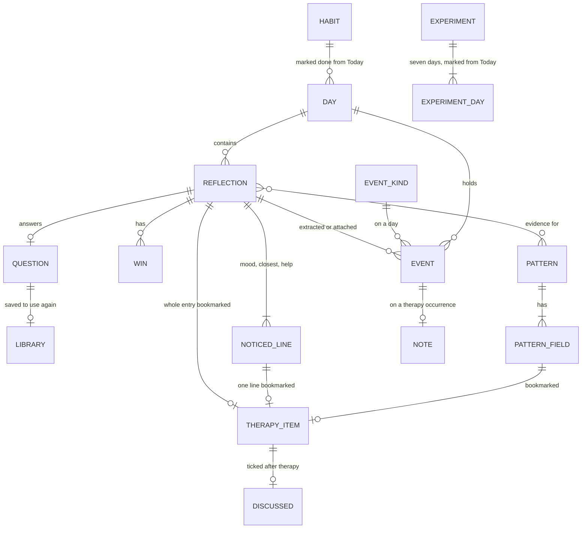
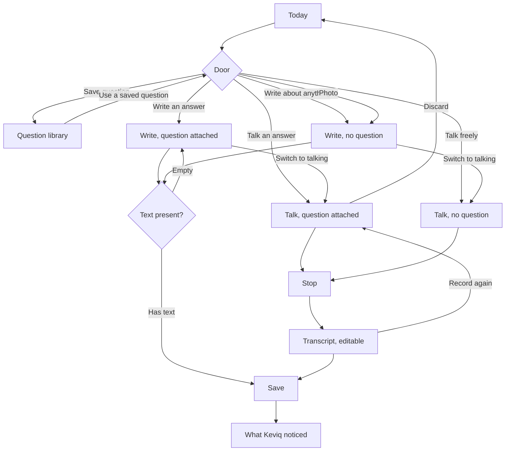
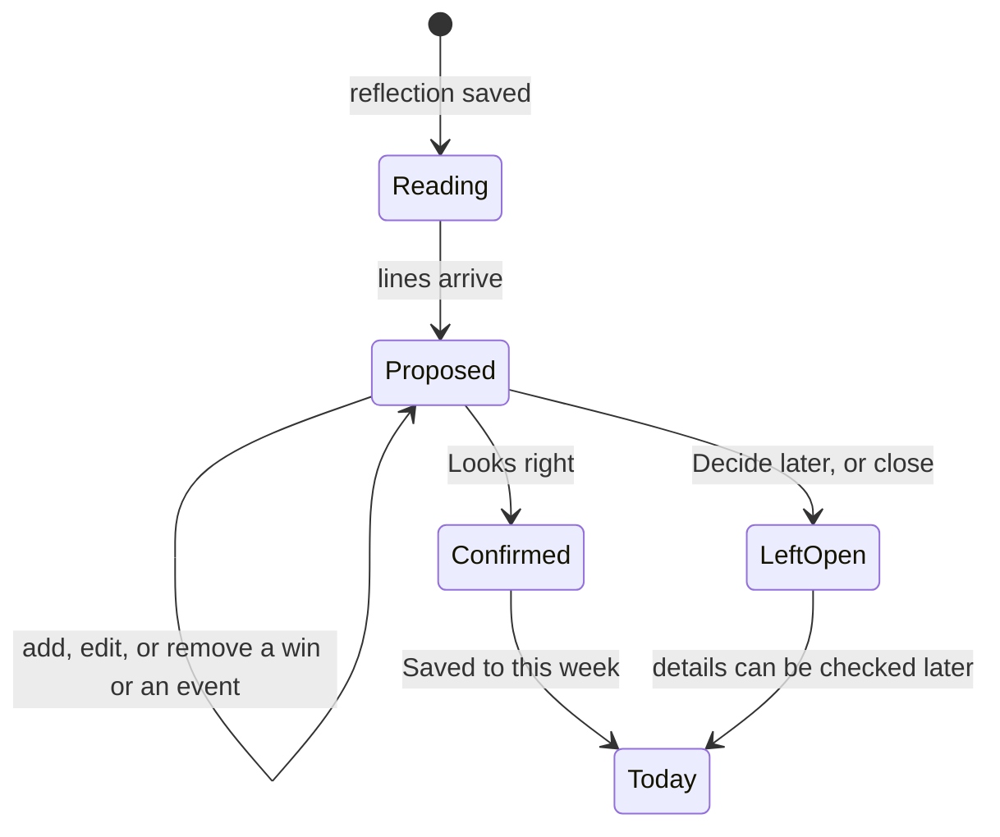
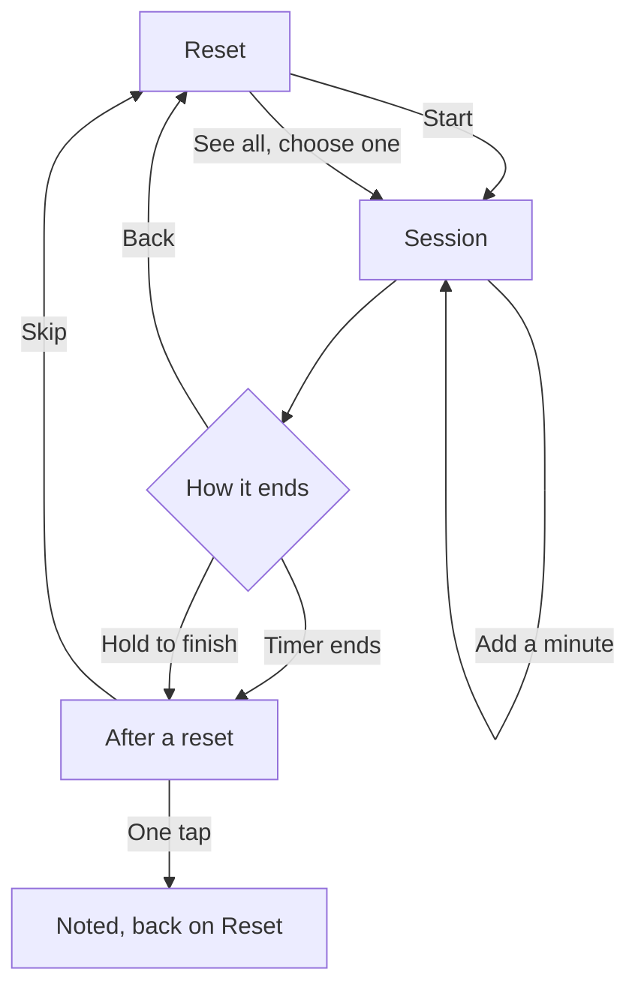
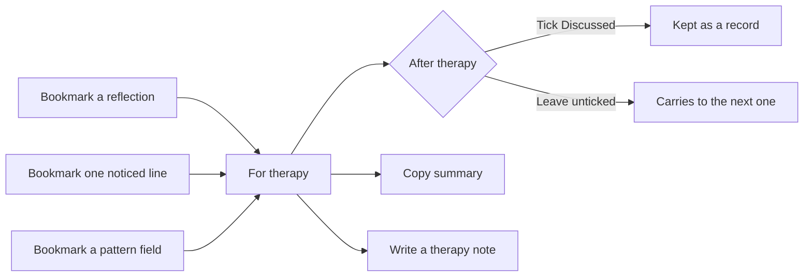

# Keviq

Keviq is the hours between therapy sessions. The line is: **therapy is one hour. What about the other 167?**

It is a private place to write or speak a reflection, let Keviq notice a few things in it, and carry the useful pieces to the next session. It also holds short body resets, a thinking partner (the Guide), and a record of what keeps coming up.

Keviq is not therapy, a clinical record, or a diagnosis.

Data model: `datamodel.md` (this folder) — companion design doc; behavior stays specified here.

---

## Home

Two areas. Swipe or use the tab bar to move between them.

| Area | For |
| --- | --- |
| **Today** | The day's question with Write and Talk, today's habits (the experiment among them), recent reflections, and the menu. |
| **Reset** | One suggested body reset, the rest of the resets, and the Guide. |

The menu, opened from Today, holds the places beyond the daily action: For therapy, Calendar, Patterns, the full habits and experiments screen, Small wins, Profile and privacy. The question library is opened from today's question.

From three days before a confirmed therapy occurrence, Today says when it is ("Therapy is in 3 days", then "tomorrow", "today"); otherwise it says nothing. The reminder the day before is a separate notification, off unless the person turns it on.

Back, or closing a sheet, returns to the screen underneath. The two tabs are the only navigation that stays on screen.

---

## What a reflection is

A reflection is the unit of the product.

| Field | Meaning |
| --- | --- |
| Text | The person's words. Written, or a transcript. Editable later. |
| Mode | Write or voice. Voice becomes text on the phone as they speak. The recording is uploaded and kept with the reflection, private, and the AI re-reads it. |
| Photo | At most one. Private. Stays inside the reflection. |
| Question | Set only when the reflection answers today's question. Free writing has none. |
| How it felt | One mood. |
| What it feels closest to | One label. |
| What might help most | One label. |
| Small wins | Zero or more short lines. Keviq's come with a kind; the person's own don't need one. |
| Events | Zero or more. Added by the person, or extracted by Keviq. |
| Marks | The whole reflection, or any single noticed line, can be bookmarked for therapy. |
| Guide exclusion | Per entry. On means the Guide will not use this reflection. |

A noticed line is in one of three states:

- **Proposed.** Keviq's guess. Not yet accepted.
- **Confirmed.** The person picked it, edited it, or tapped Looks right.
- **Blank.** Keviq will not guess. The person can fill it, or leave it empty.

The closed sets Keviq draws from:

- **Moods — settled.** Calm, Content, Light.
- **Moods — lifted.** Hopeful, Energised, Proud, Grateful.
- **Moods — activated.** Anxious, On edge, Panicky, Restless, Wired, Irritated, Angry, Overwhelmed.
- **Moods — heavy.** Sad, Lonely, Empty, Flat, Numb, Drained, Heavy, Tender, Ashamed, Hurt, Resentful.
- **Closest to.** Pressured, Overlooked, Stretched thin, Falling behind, Unsure of myself, Stuck, Alone in this, Disconnected, Not enough, Too much, Guilty, Relieved, Understood, Safe.
- **What might help.** Space to slow down, Being heard, A clear boundary, A plan, A smaller step, Rest, Moving my body, Company, Kindness to myself, Something fun.
- **Win kinds.** Spoke up, Looked after myself, Held a boundary, Connected, Finished something, Tried something new, Kept going. A win the person adds is labelled "Added by you" and starts confirmed; picking a kind is optional.

**Events** are things that happened or are planned: a fight, a bad day at work, an outing with friends, anything the person adds. **Therapy** is the one kind Keviq already knows, and Keviq can extract it the same way as any other. The person can delete it. An event sits on a day. A confirmed therapy occurrence can hold a note in the person's words, and can repeat.

**Questions** the person wants to keep go into a library and can be used again.

**Patterns** are aggregates over a period: five fields, the reflections they came from, and a short narrative.

**One experiment** runs at a time, for seven days, then asks for an outcome. **Habits** are ongoing and can be paused. Both are marked for today from the home screen. **Small wins** are short lines the person keeps — their own additions, or lines lifted from a reflection — listed in the menu. Any win can become a share card.

---

## Capture

Today has two doors into the same save.

- **Today's question.** One prompt. Write an answer, talk an answer, swap to another question, save it to the library, or hide it for the rest of the day. Hidden, it can be brought back.
- **Free capture.** Write about anything, attach one photo, or talk with no prompt. No mode has to be chosen first.

On screen, Today shows one set of Write and Talk, on the question card. Free capture is the same Write or Talk with **No question** chosen: under the question in Write and Talk, a choice between Today's question and No question switches the door without leaving the screen. While the question is hidden for the day, Write and Talk sit on the hidden-question bar and open with no question.

**Question library.** Saving a question keeps it. From the library the person can use a saved question as today's prompt, or remove it. Keviq's own rotating questions stay available either way. A saved question is the person's to reuse. It is not answered until they choose it.

**Write.** The question is shown when the reflection is an answer to it; choosing No question removes it. The field starts empty ("What happened? Start anywhere."). One photo can be added or removed. The person can switch to talking, or save. Save with an empty field asks for a few words and does not proceed.

**Talk.** The question stays in view, or a free prompt if there is none ("Say whatever's on your mind."). The same Today's question / No question choice sits under it. A timer runs while they speak, and their words become text on the phone as they speak (on-device speech recognition — sherpa-onnx). Discard throws the recording away and returns. Stop shows the editable transcript with Record again and Save. On save, the recording is uploaded and kept with the reflection.

The audio contract: the person's words become text on the phone as they speak (sherpa-onnx). That text is what they edit and what gets saved. The recording is also uploaded and kept with the reflection — private, like the photo — and the AI reads the text and the recording together, including on every later pass.

---

## What Keviq noticed

Saving opens a review. The reflection is already saved.

Keviq reads first, and confirm stays unavailable until the lines are ready. Then five groups:

| Group | When Keviq has a guess | When Keviq does not |
| --- | --- | --- |
| How it felt | A proposed mood | — |
| What it feels closest to | A proposed label | Left blank. The guess is offered in the picker, not filled in. |
| What might help most | A proposed label | — |
| Small wins | Proposed lines, each with a kind | Add a win |
| Events | One or more proposed events, such as a fight or an outing | Add an event |

Tapping a line opens a picker. Keviq's suggestion is marked as a suggestion. Choosing a value confirms it. "Leave this blank" clears a field. A win's picker sets its kind. An event's picker chooses a kind the person already has, or a new one they name.

Confirming an extracted event the person does not already keep adds that kind to their events, and places the occurrence on the reflection's day. Therapy is included. Dismissing or deleting it leaves no schedule behind.

The header bookmark marks the **whole reflection** for therapy. It does not confirm the guesses.

**Looks right** confirms every line that has a value, including wins and events, then returns to Today. **Decide later** and close return without confirming. Unconfirmed guesses stay proposed on the reflection. Nothing on this screen is required.

---

## A saved reflection

Opened from This week, the calendar, a pattern's evidence, or For therapy.

It shows the photo if there is one, the question if it answered one, and the text, still editable. A voice entry is labelled as spoken, and the recording stays with it. Under "What Keviq noticed," each line has its own bookmark, so one interpretation can go to therapy without the whole entry. Wins and events can be added, changed, or removed. The question on the entry can be saved to the library.

If the entry is evidence for a pattern, a link opens that pattern.

Actions:

- Talk this through → the Guide
- Save as a win
- Keep out of the Guide
- Delete. A second tap confirms.

---

## Reset

Reset opens on one suggestion and Start. A short picker offers the other resets without leaving the screen. The default is labelled "Suggested for right now." After a change, "Your pick." See all opens the same six, shortest first.

| Reset | Length | Group |
| --- | --- | --- |
| Slow breath | 90 sec | Under two minutes |
| Five senses | 1 min | Under two minutes |
| Hand on heart | 1 min | Under two minutes |
| Shake it out | 2 min | A little longer |
| Sounds around you | 2 min | A little longer |
| Body scan | 3 min | A little longer |

The Guide is reached from Reset, and also from a reflection or a pattern.

**Session.** A timed guide for the chosen reset. Body cues name where to soften: jaw, shoulders, belly. The instruction alternates breathe in and breathe out. Progress runs for the duration. **Hold to finish** must be held for 1.2 seconds. Releasing early cancels, so a tap does not end the session. Back leaves without a check-in. **Add a minute** extends the duration.

**After a reset.** Optional, one tap: Calmer, A bit better, Same, Worse, Tired, Numb. Skip is equal to answering. This check-in is the only link between a reset and a feeling.

---

## Guide

The Guide helps the person think something through. It does not diagnose, and it says so.

Three modes. Each names itself, asks one opening question, and says which reflection it starts from. About ten minutes. The person can move to the next mode.

| Mode | Job | Starts from |
| --- | --- | --- |
| Make sense | Untangle what happened | A recent reflection |
| Close the loop | Finish a thought that keeps returning | The entry that left it open |
| Learn | Notice what to keep or change | A reflection with a small win |

The conversation lists its sources up front, with a way to change them in privacy. When a reply uses a therapy note, it links to that note. The same conversation is reachable from a reflection and from a pattern.

The Guide reads therapy notes only while that privacy switch is on. It skips any reflection marked "Keep out of the Guide."

---

## Events

An event is a kind plus a day.

The person builds their own kinds: a fight, a bad job, an outing with friends, and whatever else they name. **Therapy** is the only kind Keviq supplies, and it is extracted like the rest. A proposed therapy event can be confirmed, changed, or deleted. Until one is confirmed, Keviq has no therapy schedule, no next occurrence, and no reminder the day before. Deleting the last one clears that schedule.

An occurrence lands in two ways:

- The person adds it, on a day, or on a reflection.
- Keviq extracts it from a reflection and proposes it. The same rules as other noticed lines: proposed until the person confirms, changes, or removes it. Looks right confirms it. A kind Keviq has not seen before becomes one of theirs when they confirm it.

A therapy occurrence can repeat when the person adds it that way — kind Therapy with a repeat interval in days — and can hold a note in the person's words. Other events are markers on the day and on the reflections that mention them. They do not open For therapy.

---

## For therapy

The list the person takes into their next therapy occurrence. It is there once a therapy event has been confirmed. Keviq does not send it.

Each item is labelled by source:

- **Your words.** A bookmarked reflection, with its text.
- **Keviq noticed.** One field from a reflection.
- **From a pattern.** One field from a pattern, such as what helped.

Open returns to the reflection or the pattern. The screen shows the next therapy occurrence, when the last one was, and two counts since then: reflections, and the leading pattern. **Copy summary** puts the list on the clipboard. **Note** saves the person's own words onto that therapy occurrence.

Nothing on this screen is shared with a therapist unless the person copies it.

---

## Calendar

A month of days. Reflections and events are both visible on a day. Up to three reflections are indicated; the day panel lists the entries and the events themselves.

Selecting a day shows its reflections and its events. The person can add an event to that day, including Therapy, or remove one. A confirmed therapy occurrence shows its note, if one was written, and an upcoming one points at For therapy. Calendar and For therapy open each other.

---

## Patterns

Three periods: Last 2 weeks, Since last therapy, Month. Since last therapy is available once a therapy event has been confirmed and has passed.

A period with fewer than five new reflections since the last pattern generation does not invent a pattern. It says how many there are, and how close that is to five.

When there is enough, the strongest pattern leads, with how often it came up, what shifted, and what helped. Further patterns follow, each with a count. A topic that has started but not formed yet says so, and how close it is.

Pattern detail is ordered: the five fields, then the source reflections, then a short narrative.

| Field | Answers |
| --- | --- |
| What repeated | The recurring observation |
| What shifted | What changed versus the previous period |
| What's underneath | The closest-to label that dominates |
| What helped | Resets or habits followed by a better check-in |
| What didn't | The same, with no change |

Any field can be bookmarked for therapy. Source reflections open from the detail. The period shows where the last therapy occurrence fell, when there is one. Talk this through opens the Guide on this pattern.

---

## Habits and experiments

Today shows the active experiment and the habits that are on, because that is where the person acts on them. On Today the experiment sits among the habits and is marked the same way, labelled with its day ("Trying, day 5 of 7"). Its question, the state of each day, and the outcome are shown on the habits screen.

From Today they mark the experiment done for today, and mark each habit done for today. That is the whole daily action. Pause, the end-of-week outcome, and ideas to try live on the habits screen, one tap away.

One experiment at a time. It states a question, which day of seven it is, and the state of each day: done, missed, today, or still ahead. When the week ends, the person picks Helped, No change, or Didn't help. Helped is a signal the Guide may later offer as a habit. Finishing the week has no score.

Habits each show on or off, a count for the period ("5 of 7"), and a one-line effect ("mood lifts after most"). Pausing a habit takes it off Today and drops the count until it is resumed. The count describes the period. It is not a streak, and a missed day is not announced as one.

Below the habits, on that screen, a shelf of ideas to try — the experiments library (`experimentslibrary.md`). The shelf shows a few ideas and opens **Ideas to try**, the whole library in its groups.

Each idea shows what it shifts, when it fits (in the moods and closest-to labels Keviq already uses), and three ways to run it for seven days. The library can be filtered by those labels. Picking a way starts it as the experiment, and the picked line becomes its question. While an experiment is running, picking another says when it can start. There is still only one at a time.

The running experiment can be turned into a share card ("Share this week").

---

## Share cards

A card the person can post anywhere they like. It is made to be shared, and it is not for therapy.

| Source | Where | On the card |
| --- | --- | --- |
| One small win | The share icon on any win in Small wins | The win's line, and its kind if it has one |
| The experiment they're trying | "Share this week" on the habits screen | "I'm trying:" and its name, and the idea it came from |

The card is portrait (9:16), carries the Keviq mark and the column art, and comes in three styles: Carbon, Concrete, and Cord. **Save image** keeps it in photos. **Share** opens the phone's share sheet.

Only what is on the card leaves Keviq. A card never carries reflection text, a mood, a closest-to or might-help label, a pattern, an event, therapy, a therapy note, a photo, or the recording. Keviq never posts on its own, and nothing is shared until the person taps Share. There is no sharing with chosen people inside Keviq.

---

## Profile and privacy

| Group | Contains |
| --- | --- |
| Your people | Up to three contacts. Each is marked friend, therapist, or helpline. |
| Therapy | Shown once a therapy event is confirmed. Its repeat, its next occurrence, and the calendar. Deleting the last one removes it. |
| Privacy | Guide can read therapy notes, on, and overridable per entry. Hide the question on the home-screen widget. Lock with Face ID. Export my data. Delete everything. |
| Notifications | Off. Two optional ones exist: a weekly question, and a reminder the day before a confirmed therapy occurrence. |

---

## People

The person can keep up to three contacts. Each one is marked friend, therapist, or helpline, in any mix. They add the name and the number. Keviq does not supply a therapist, a regional line, or an emergency number.

Contacts live in profile. They are not part of Today or Reset. A mood, a pattern, or a check-in never opens them. Keviq shows the number. The person places the call.

---

## Feature index

| Feature | Where | What it does |
| --- | --- | --- |
| Today's question | Today | One prompt. Answer, swap, save, or hide for the day. |
| Question library | Today's question | Saved questions, used again when the person picks one. |
| Free capture | Write and Talk (No question) | Write, talk, or attach a photo without a prompt. |
| Voice | Talk | Words become text on the phone as they speak. The recording is uploaded and kept with the reflection, and the AI re-reads it. |
| Noticed lines | Review, reflection | Mood, closest-to, what might help, small wins, events. A guess until confirmed. |
| Events | Review, calendar, reflection | Kinds the person adds, plus Therapy, which Keviq already knows. Occurrences come from the person or from extraction, and can be deleted. |
| Leave it blank | Review, reflection | Low confidence stays empty until the person fills it. |
| Bookmark | Review, reflection, pattern | Whole entry, one line, or one pattern field, for therapy. |
| This week | Today | Recent reflections. Opens the entry. Links to the calendar. |
| Reset library | Reset | Six short body resets. One tap starts one. |
| Reset session | Session | Timed, with body cues. Ends on a hold, or when time runs out. |
| After a reset | Sheet | Optional one-tap feeling. Skip is equal. |
| Guide | Reset, reflection, pattern | Three modes, drawn from the person's own material, with sources shown. |
| For therapy | Menu | The carry-list, once a therapy event is confirmed. Sources labelled. Discussed ticks. Copy. |
| Therapy note | For therapy, calendar | The person's words on a therapy occurrence. The Guide may read it. |
| Calendar | Menu | Days, events, reflections, notes. |
| Patterns | Menu | What repeats in a period, or a clear "not enough yet." |
| Experiment | Today, and Habits | Mark today from the home screen, among the habits. One seven-day question, then an outcome. |
| Habits | Today, and Habits | Mark today from the home screen. On, paused, and a count for the period. |
| Small wins | Menu, reflection | The person's kept lines and own additions, in one list. Any win can become a share card. |
| Ideas to try | Habits | The experiments library in full: shift, when it fits, three ways to run each, filtered by feeling. |
| Share card | Small wins, Habits | A win or the current experiment as a 9:16 card to save or post. Nothing else leaves. |
| People | Profile | Up to three contacts, each marked friend, therapist, or helpline. The person dials. |
| Lock, export, delete | Profile | Face ID, a data export, and delete everything. |

---

## Rules

- A reflection is saved before any noticed line is accepted. Confirming is optional.
- Keviq can extract any event, including therapy. It stays proposed until the person confirms it, and they can delete it.
- "Your words", "Keviq noticed", and "From a pattern" stay distinct on the therapy list.
- A therapist receives nothing unless the person copies it.
- The recording stays with the reflection, private. The AI re-reads it on every pass. It never leaves on a share card.
- Photos stay inside the reflection.
- The Guide cites a therapy note when it uses one, and skips entries the person has excluded.
- A reset ends on a deliberate hold, or when its timer ends. Back leaves without the check-in.
- Contacts are limited to three, each marked friend, therapist, or helpline. Keviq does not supply the numbers, does not surface them on Today or Reset, and does not place the call.
- Habits and the home-screen widget carry no streaks, scores, levels, or missed-day messages.
- A share card carries only its own line (a win, or the experiment's name), plus that line's kind or source idea. Keviq never posts, and never puts reflection text, feelings, patterns, events, therapy, photos, or the recording on a card.
